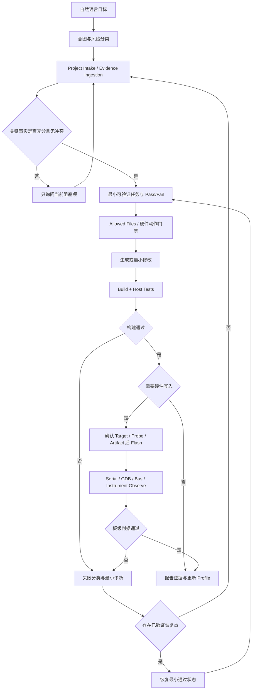

# VibeBoard 集成状态机

## 总体流程



## 统一数据合同

### `project_profile`

```json
{
  "target": {
    "mcu": null,
    "variant": null,
    "package": null,
    "board": null,
    "flash_bytes": null,
    "ram_bytes": null
  },
  "hardware": {
    "clock": [],
    "power_rails": [],
    "pinmap": [],
    "boot_config": [],
    "protected_resources": []
  },
  "firmware": {
    "sdk": null,
    "rtos": null,
    "toolchain": null,
    "build_system": null,
    "generated_code": []
  },
  "execution": {
    "build_entry": null,
    "artifact": null,
    "probe": null,
    "flash_entry": null,
    "serial_port": null,
    "baud_rate": null
  }
}
```

所有非空值都应通过 `evidence_id` 关联到 Evidence Store，不能只有裸值。

### `evidence`

```json
{
  "id": "ev_...",
  "claim": "HSE is 8 MHz",
  "status": "CONFIRMED",
  "source_type": "schematic|datasheet|build_config|source|log|measurement|user",
  "source": "path-or-url",
  "locator": "page/section/symbol/line",
  "version": "document-or-revision",
  "observed_at": "ISO-8601",
  "conflicts_with": []
}
```

允许状态：`CONFIRMED`、`INFERRED`、`UNKNOWN`、`CONFLICT`、`UNVERIFIED`。

### `task_contract`

```json
{
  "goal": "Read sensor WHOAMI over I2C",
  "non_goals": ["unit conversion", "cloud upload"],
  "allowed_files": [],
  "protected_areas": [],
  "risk_level": "L1",
  "pass_fail": [],
  "rollback": [],
  "blocking_questions": []
}
```

### `run_result`

```json
{
  "state": "succeeded|failed|blocked|partial",
  "failure_class": null,
  "commands": [],
  "artifacts": [],
  "evidence_ids": [],
  "profile_patch": {},
  "next_actions": [],
  "recovery_point": null
}
```

## 阶段与 Skill 映射

| 阶段 | 参考 Skill | 退出证据 |
|---|---|---|
| 产品/需求 | `market-mrd-analyst`、`mrd-to-prd`、`embedded-prd-to-logic` | 冻结约束、MVP、验收标准和未知项 |
| 工程接入 | `embedded-project-intake` | MCU/构建/入口/运行流的证据化 Profile |
| 资料接入 | `chip-resource-finder`、`parsed-chip-datasheet`、`chip-driver-manual` | 精确版本手册、结构化寄存器/时序/约束和冲突 |
| 硬件接入 | `schematic-pinmap-analyzer` | 电源树、Pin Map、信号路径和待确认风险 |
| 方案/架构 | `NextBoard`、`prd-to-hardware-solution`、`embedded-architecture-planner` | 候选比较、选定架构、接口合同和验证计划 |
| 修改保护 | `embedded-llm-guardrails` | Allowed Files、保护区、风险等级和回滚 |
| 最小工程 | `vendor-minimal-firmware`、`embedded-project-scaffold` | 官方来源、可构建基线和 Artifact Manifest |
| 构建/测试 | `embedded-build-flash-debug`、`build-*`、`embedded-unit-test-generator` | 命令、退出码、日志、测试和可烧录产物 |
| 烧录 | `flash-*` | 已确认 Target/Probe/Artifact、烧录日志和校验结果 |
| 观测 | `serial-monitor`、`debug-*`、`rtos-debug` | 启动日志、寄存器、回溯、线程状态 |
| 信号/协议 | `logic-analyzer`、`visa-debug`、`can-debug`、`modbus-debug` | 波形、测量值、解码帧和明确 Pass/Fail |
| 诊断/交付 | `embedded-bug-hunter`、`memory-analysis`、`static-analysis`、`embedded-change-report` | 根因证据、残余风险、变更和验证报告 |

## 风险门禁

| 等级 | 例子 | 默认策略 |
|---|---|---|
| L0 | 读取、搜索、解析、生成报告、静态分析 | 自动执行并记录来源 |
| L1 | Allowed Files 内修改、构建、主机测试 | 在任务授权内执行，保留 Diff 和恢复点 |
| L2 | 烧录、复位、串口写命令、总线发帧、EDA 写入、仪器控制 | 执行前展示精确目标、动作和预期影响 |
| L3 | 全片/范围擦除、Fuse/Option Bytes、Bootloader/分区、生产/校准参数、电源危险动作 | 每次显式确认；必须有恢复说明，无法恢复则明确告知 |

多个串口、探针、板卡、产物或配置同样合理时，返回 `ambiguous-context`，禁止自动选择第一个。

## 统一失败分类

- `environment-missing`：工具或依赖缺失。
- `artifact-missing`：ELF/HEX/BIN/MAP 或配置未生成。
- `permission-problem`：串口、USB、文件或凭证权限不足。
- `connection-failure`：探针、串口、仪器或网络连接失败。
- `project-config-error`：MCU、链接、工具链、设备名或配置不匹配。
- `ambiguous-context`：存在多个合理目标，无法安全自动选择。
- `target-response-abnormal`：设备可连接但启动、运行或响应异常。
- `evidence-conflict`：手册、原理图、构建文件或用户信息冲突。
- `verification-failed`：执行完成但未达到 Pass/Fail 标准。

失败结果必须带原始证据、已排除项、下一条最小诊断动作，不能只返回“请检查连接”。

## 状态回写原则

- Build 成功只更新 `artifact` 和构建证据，不把功能标为已验证。
- Flash 成功只更新设备写入证据，不把启动标为成功。
- 串口、GDB、波形或仪器达到明确判据后，才标记对应硬件行为已验证。
- 已验证代码记录验证日期、板卡/版本、测试条件和 Evidence ID；后续改动自动使关联验证失效。
- 每轮最终生成 Change Report，列修改、验证、未验证、风险和恢复点。
